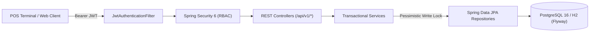

# POS & Inventory Enterprise REST API


A production-structured **Spring Boot 3** backend service for Point-of-Sale (POS) checkout, real-time inventory control, role-based access, and daily revenue reporting — the cloud-native REST API counterpart to my [POS & Inventory Desktop Suite](https://github.com/damsarachethiyaa-dev/POS-Inventory-Management-System).

---

## Architecture



## Key Engineering Highlights

- **Stateless JWT Authentication & RBAC:** Spring Security 6 with HMAC-SHA256 JWTs, BCrypt password hashing, and method-level `@PreAuthorize` guards separating `ADMIN` and `CASHIER` permissions.
- **Concurrency-Safe Transactional Checkout:** `@Transactional` checkout merges duplicate line items, acquires deterministic-order `PESSIMISTIC_WRITE` row locks to prevent deadlocks and overselling, computes currency values with `BigDecimal` (`HALF_UP`), and rolls back atomically on insufficient stock.
- **Flyway Schema Migrations:** Versioned SQL schema (`V1__init_schema.sql`) with `ddl-auto: validate` so JPA mappings are strictly checked against the database schema at startup.
- **RFC 7807 Error Handling:** Centralized `@RestControllerAdvice` returning standard `ProblemDetail` payloads for validation errors (`400`), auth failures (`401`/`403`), missing records (`404`), and stock/uniqueness conflicts (`409`).
- **Interactive OpenAPI 3 / Swagger UI:** Ready-to-test API documentation at `/swagger-ui.html` with JWT bearer authentication configured.
- **Automated Verification & Containers:** JUnit 5 + Mockito unit tests, full Spring `MockMvc` integration tests, GitHub Actions CI, and a non-root multi-stage `Dockerfile` + `docker-compose.yml` with PostgreSQL 16.

---

## API Endpoints

| Method | Endpoint | Role | Description |
| :--- | :--- | :--- | :--- |
| `POST` | `/api/v1/auth/login` | Public | Authenticate and receive a JWT access token |
| `POST` | `/api/v1/auth/register` | `ADMIN` | Register a new staff account (`ADMIN` or `CASHIER`) |
| `GET` | `/api/v1/products` | Authenticated | Paginated product catalog (`search`, `category`, `page`, `size`) |
| `GET` | `/api/v1/products/{id}` | Authenticated | Fetch product by ID |
| `GET` | `/api/v1/products/barcode/{barcode}` | Authenticated | Instant barcode lookup for POS scanner checkout |
| `GET` | `/api/v1/products/low-stock` | Authenticated | List products at or below their reorder threshold |
| `POST` | `/api/v1/products` | `ADMIN` | Add a new SKU to the inventory catalog |
| `PUT` | `/api/v1/products/{id}` | `ADMIN` | Update product metadata, price, and reorder threshold |
| `PATCH` | `/api/v1/products/{id}/restock` | `ADMIN` | Atomically increment product stock |
| `POST` | `/api/v1/sales/checkout` | `ADMIN`, `CASHIER` | Process transactional checkout & deduct inventory |
| `GET` | `/api/v1/sales/receipt/{receiptNumber}` | Authenticated | Fetch sale details by receipt number |
| `POST` | `/api/v1/sales/{id}/void` | `ADMIN` | Void a sale and atomically restore inventory |
| `GET` | `/api/v1/sales/summary?date=YYYY-MM-DD` | `ADMIN` | Daily completed transaction count, subtotal, tax & gross revenue |
| `GET` | `/actuator/health` | Public | Service health check |

---

## Quick Start

### Option 1: Run Locally (Zero Setup — H2 in PostgreSQL Mode)

```bash
./mvnw spring-boot:run
```

Open Swagger UI at **http://localhost:8080/swagger-ui.html**

Seeded demo accounts (when `APP_SEED_ENABLED=true`):
- **Admin:** `admin` / `Admin@1234`
- **Cashier:** `cashier` / `Cashier@1234`

### Option 2: Run with Docker Compose (PostgreSQL 16)

```bash
docker compose up --build
```

### Run Automated Tests

```bash
./mvnw verify
```

Includes:
- **`SaleServiceTest`** — JUnit 5 + Mockito unit tests verifying tax/subtotal math, stock deduction, insufficient-stock rejection, and void restocking.
- **`PosApiIntegrationTest`** — Full `@SpringBootTest` + `MockMvc` end-to-end tests verifying `401`/`403` RBAC, product CRUD, barcode lookup, transactional checkout, `409 Conflict` stock rollback, low-stock alerts, void/restock, and Actuator health.

---

## Author

**Chethiya Rathnasekara** — [Portfolio](https://damsarachethiyaa-dev.github.io/github-portfolio/) · [LinkedIn](https://www.linkedin.com/in/chethiya-rathnasekara-40b0913b2/)
